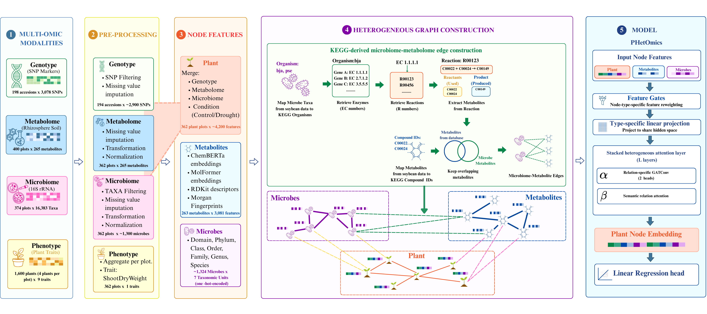

# PHetOmics

**PHetOmics** is a heterogeneous graph neural network for predicting plant phenotypes from
multi-omics data. It models plants, root-associated microbes, and metabolites as three
node types in one graph, connects them with biologically meaningful edges (taxonomy,
chemical similarity, KEGG reaction links, and per-plot observation edges), and predicts a
plant trait on the plant nodes with relation-level attention.

The repository contains the full pipeline: leakage-safe preprocessing, graph construction,
the PHetOmics model, classical ML and homogeneous GNN baselines, a PyG `HANConv` reference
model, and the result tables from the final runs.

---

## Repository layout

```
PHetOmics/
├── Code_final_model/
│   ├── 00_preprocess.py                       # split + preprocess the four omics tables per seed
│   ├── 01_a_metabolome_smiles.py              # look up SMILES for metabolites on PubChem
│   ├── 01_b_create_final_compound_smiles.py   # merge automatic + manual SMILES, resolve CIDs
│   ├── 01_c_metabolome_nodes_edges.py         # metabolite node features + similarity edges
│   ├── 02_microbiome_taxonomy_nodes_edges.py  # microbe node features + taxonomy edges
│   ├── metabolome_seed_helpers.py             # shared helpers for metabolite column handling
│   ├── PHetOmics.py                           # PHetOmics  model
│   ├── original_han.py                        # reference HAN built on torch_geometric HANConv
│   ├── gnn_baselines.py                       # GCN / GraphSAGE / GIN baselines
│   ├── ml_baselines.py                        # RandomForest / SVR / MLP / XGBoost baselines
│   ├── raw_dataset/                           # raw input tables
│   ├── preprocessed/                          # per-seed splits + per-seed graph files
│   └── graph_output/                          # global metabolite / microbe graph artefacts
└── Latest_Results/                            # exported node / edge tables for inspection
```

---

## Data

Raw inputs live in `Code_final_model/raw_dataset/`.

| File | Contents | Shape |
|---|---|---|
| `phenotype.csv` | Plant-level phenotype measurements (9 traits) with field metadata | 1600 plants × 18 |
| `metabolome.csv` | Metabolite abundances per plot | 400 × 274 |
| `microbiome.csv` | Microbial abundance per plot, taxa as column names | 374 × 16 458 |
| `genoMarker_LD0.001_SNP3078.csv` | SNP markers per variety (LD-pruned) | 198 varieties × 3078 SNPs |

Phenotype traits available: `LeafDryWeight_g`, `ShootDryWeight_g`, `ShootFreshWeight_g`,
`LeafFreshWeight_g`, `GrowthStage`, `NumberOfNodes`, `NumberOfTillers`, `PlantHeight_cm`,
`TillerLength_cm`. The reported model predicts **`ShootDryWeight_g`**.

An additional file, `preprocessed/microbe_metabolite_biological_edges.csv`, holds
microbe → metabolite `produces` / `uses` edges derived from KEGG reaction logic. It is
provided as data and is not generated by the scripts in this repository.

---

## Pipeline

All scripts are run from inside `Code_final_model/` and use relative paths.

### 1. Preprocessing — `00_preprocess.py`

Builds 20 independent train/validation/test splits (seeds 42–61) under
`preprocessed/seed_<N>/`.

- Phenotype is aggregated from plant level to plot level by median. Plots missing any
  selected target trait are dropped before splitting.
- Splits are **grouped by variety** (70 / 15 / 15) so no variety leaks across splits.
- Every learned transform is fit on the training split only and applied to val/test:
  - Genotype: MAF ≥ 0.05 filter, most-frequent imputation, standard scaling.
  - Metabolome: `log1p`, median imputation, variance filter, standard scaling.
  - Microbiome: prevalence ≥ 0.05 filter, CLR transform (pseudocount 1), standard scaling.
- Phenotype columns are written only to `y_*.csv`; they never appear in omics files.

Per seed this yields roughly 253 / 54 / 55 plots and ~2900 SNPs, 265 metabolites, and a
seed-dependent set of microbes.

### 2. Metabolite graph — `01_a`, `01_b`, `01_c`

1. `01_a_metabolome_smiles.py` queries PubChem for SMILES of every metabolite column and
   writes matched/unmatched audit tables to `graph_output/compound_smiles_mapping/`.
2. `01_b_create_final_compound_smiles.py` merges automatic matches with a manually curated
   mapping (`compound_smiles_unmatched_manual.csv`), applies known name corrections, and
   produces `compound_smiles_final.csv`.
3. `01_c_metabolome_nodes_edges.py` computes four kinds of molecular representation from
   SMILES and averages their cosine similarities:
   - RDKit physicochemical descriptors
   - Morgan fingerprints (radius 2, 2048 bits)
   - ChemBERTa embeddings (`seyonec/ChemBERTa-zinc-base-v1`)
   - MoLFormer embeddings (`ibm/MoLFormer-XL-both-10pct`)

   Global outputs go to `graph_output/metabolome_global/`; per-seed node features and
   `metabolite — similar_to — metabolite` edges (similarity ≥ 0.80) are written to
   `preprocessed/seed_<N>/graph_metabolome/`.

### 3. Microbe graph — `02_microbiome_taxonomy_nodes_edges.py`

Maps each retained `mb_*` column back to its raw taxonomy string, encodes taxonomy ranks
as numeric node features (no abundance values), and creates
`microbe — same_taxonomy — microbe` edges between microbes sharing the exact same genus or
species. Outputs are written to `preprocessed/seed_<N>/graph_microbiome/`.

### 4. Model training

Each training script tunes over the same hyperparameter grid on the validation split,
selects by validation MAE, and evaluates the test split once with the chosen config.
Metrics reported: R², RMSE, MAE, Pearson, Spearman, aggregated across the 20 seeds.

| Script | Models | Output folder |
|---|---|---|
| `PHetOmics.py` | **PHetOmics** heterogeneous GNN | `PHetOmics_results_test/` |
| `original_han.py` | PyG `HANConv` reference | `original_han_results/` |
| `gnn_baselines.py` | GCN, GraphSAGE, GIN on a plant-only graph | `gnn_results_tuned/` |
| `ml_baselines.py` | RandomForest, SVR (RBF), MLP, XGBoost | `ml_results_flexible_targets/` |

---

## The PHetOmics model

### Graph

| Node type | Features |
|---|---|
| `plant` | Concatenated preprocessed genotype + metabolome + microbiome features for the plot |
| `microbe` | Numeric taxonomy encoding |
| `metabolite` | RDKit, Morgan, ChemBERTa and MoLFormer embeddings |

| Edge type | Source |
|---|---|
| plant — similar_to — plant | Pearson correlation of plant features ≥ 0.70 |
| microbe — same_taxonomy — microbe | Shared genus / species |
| metabolite — similar_to — metabolite | Averaged chemical similarity ≥ 0.80 |
| microbe — produces / uses — metabolite | KEGG-derived biological edges (plus reverse) |
| plant — has_microbe — microbe | Top-50 positive microbe values per plot (plus reverse) |
| plant — has_metabolite — metabolite | Top-50 positive metabolite values per plot (plus reverse) |

The plant → microbe / metabolite observation edges are what let the biological graph
influence the phenotype prediction; without them plant nodes would be disconnected from the
microbe–metabolite subgraph.
## PHetOmics Architecture
<p align="center">
  
</p>
Fig. 1. Proposed PHetOmics framework for plant phenotype prediction. Preprocessed genotype, metabolome, microbiome, and phenotype data are used to construct a heterogeneous graph with plant, metabolite, and microbe nodes connected by similarity, taxonomy, observation, and KEGG-derived biological edges. PHetOmics learns plant embeddings for ShootDryWeight g prediction.

### Interpretability exports

For the selected config of every seed the script writes:

- `selected_attention_summary.csv` — semantic attention per node type / relation / layer
- `selected_edge_attention_top.csv` — top-500 edges per edge type by GAT attention
- `selected_feature_gate_importance.csv` — learned feature gate values
- `selected_gradient_feature_importance.csv` — gradient-based feature importance
- `biological_edge_mapping_audit.csv`, `edge_count_summary.csv` — graph construction audit

---


## Requirements

Python ≥ 3.9. Core dependencies:

```
numpy pandas scikit-learn matplotlib requests
torch torch_geometric
rdkit transformers          # 01_c metabolite features only
xgboost                     # optional, ml_baselines.py
```

Install PyTorch and PyTorch Geometric following their official instructions for your
CUDA/CPU setup, then:

```bash
pip install numpy pandas scikit-learn matplotlib requests rdkit transformers xgboost
```

GPU is used automatically when available; CPU works for all scripts.

---

## Reproducing

From `Code_final_model/`:

```bash
python 00_preprocess.py
```

```bash
python 01_a_metabolome_smiles.py
```

```bash
python 01_b_create_final_compound_smiles.py
```

```bash
python 01_c_metabolome_nodes_edges.py
```

```bash
python 02_microbiome_taxonomy_nodes_edges.py
```

```bash
python PHetOmics.py
```

Baselines run the same way with `ml_baselines.py`, `gnn_baselines.py`, and
`original_han.py`. Step `01_a` queries PubChem over the network and is rate-limited; the
`preprocessed/` and `graph_output/` folders are already populated, so the model scripts can
be run directly without redoing steps 00–02.

To change the target, edit `TARGET_TRAITS` at the top of the training script. Multiple
traits are supported and reported both individually and as an `AVERAGE` row.
